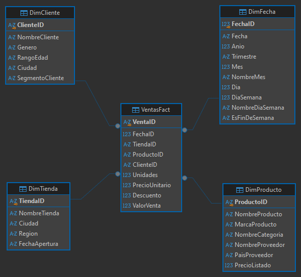
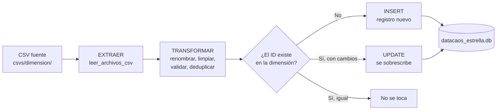

# Actualización de dimensiones - DataCaos (esquema estrella)

Construimos pipelines ETL en Python para mantener actualizadas las dimensiones **DimCliente**, **DimTienda** y **DimProducto** del Data Warehouse `datacaos_estrella`.

**Fundación Universitaria Konrad Lorenz**\
Inteligencia de Negocios - Módulo 2: Infraestructura y Procesos de Integración de Datos\
Docente: Leandro Pájaro Fuentes

**Integrantes:** Laura Valentina López García y Juan Camilo Prieto Mestizo\
**Fecha:** 29-09-2026

---

## Tabla de contenido

1. [Contexto del problema](#1-contexto-del-problema)
2. [Modelo de datos](#2-modelo-de-datos)
3. [Estructura del proyecto](#3-estructura-del-proyecto)
4. [Flujo del pipeline (ETL)](#4-flujo-del-pipeline-etl)
5. [Reglas de transformación por dimensión](#5-reglas-de-transformación-por-dimensión)
6. [Estrategia de carga: UPSERT y SCD Tipo 1](#6-estrategia-de-carga-upsert-y-scd-tipo-1)
7. [Instalación y ejecución](#7-instalación-y-ejecución)
8. [Datos de prueba y resultados esperados](#8-datos-de-prueba-y-resultados-esperados)
9. [Verificación en DBeaver](#9-verificación-en-dbeaver)
10. [Funciones agregadas al proyecto base](#10-funciones-agregadas-al-proyecto-base)

---

## 1. Contexto del problema

### El caso DataCaos S.A.

DataCaos S.A. es una empresa de retail con tiendas en varias ciudades de Colombia y una tienda en línea. Sus ventas estaban repartidas en sistemas que no se comunicaban entre sí: un ERP en Oracle para las tiendas físicas, una base MySQL para la tienda en línea y planillas de Excel que cada sede enviaba cada semana. El reporte de ventas se armaba a mano, copiando cifras de un sistema a otro, con fechas en distintos formatos y filas duplicadas por errores de digitación.

Para resolverlo, la empresa centralizó su información en un **Data Warehouse**, organizado en un **esquema estrella** para que los analistas pudieran consultar rápido. Este Data Warehouse se alimenta con **procesos ETL** en Python, que extraen los datos de cada fuente, los limpian y los cargan de forma automática.

### El problema que resuelve este proyecto

En la clase del 22 de septiembre construimos `pipeline_erp.py`, que carga las ventas de la sucursal Bogotá en la tabla de hechos **VentasFact**. Pero una venta solo tiene sentido si su cliente, su tienda y su producto existen en las dimensiones: si llega la venta de un cliente nuevo que no está en `DimCliente`, esa venta no se puede relacionar y se descarta.

Por eso las dimensiones también necesitan su propio pipeline, que:

- **agregue** los clientes, tiendas y productos nuevos, y
- **actualice** los que cambiaron (un cliente que pasa a VIP, un producto que cambia de precio, una tienda que cambia de nombre).

Para esto creamos un pipeline independiente para cada una de las tres dimensiones, reutilizando la estructura y las funciones del ETL visto en clase.

---

## 2. Modelo de datos

La base `datacaos_estrella` sigue un **esquema estrella**: una tabla de hechos central (VentasFact) rodeada de dimensiones desnormalizadas. En este proyecto actualizamos tres de sus dimensiones: DimCliente, DimTienda y DimProducto.



*Diagrama generado en DBeaver a partir de la base `datacaos_estrella`.*

> **Nota:** en el esquema estrella `DimProducto` está desnormalizada, así que la categoría y el proveedor van escritos dentro de cada producto. En el esquema copo de nieve estarían en tablas aparte (`DimCategoria`, `DimProveedor`).

Estado inicial de la base: 80 clientes, 5 tiendas, 38 productos, 366 fechas y 2.200 ventas.

---

## 3. Estructura del proyecto

```
actualizacion_dimensiones/
│
├── pipeline_cliente.py        # Pipeline de DimCliente
├── pipeline_tienda.py         # Pipeline de DimTienda
├── pipeline_producto.py       # Pipeline de DimProducto
├── pipeline_erp.py            # ETL de ventas visto en clase (base del proyecto)
│
├── utils/
│   └── reglas.py              # Funciones de limpieza y transformación
│
├── db_utils/
│   └── load.py                # Conexión a SQLite y funciones de carga
│
├── csvs/                      # Fuentes de datos
│   ├── fuente_erp_bogota.csv          # Ventas (ejercicio de clase)
│   ├── clientes/fuente_clientes.csv   # Clientes nuevos o modificados
│   ├── tiendas/fuente_tiendas.csv     # Tiendas nuevas o modificadas
│   └── productos/fuente_productos.csv # Productos nuevos o modificados
│
├── instance/
│   └── datacaos_estrella.db   # Data Warehouse (SQLite)
│
├── img/
│   └── datacaos_estrella.png   # Diagrama del modelo (DBeaver)
│
├── .env                       # Rutas de fuentes y base de datos
├── .gitignore                 # Excluye el entorno virtual
└── README.md
```

**Archivo `.env`:**

```
RUTA_ARCHIVOS=csvs
RUTA_DB=instance
```

Solo contiene rutas de carpetas, sin credenciales, por eso lo incluimos en el repositorio. El entorno virtual (`env/`) **no** lo subimos: cada persona lo crea en su equipo (ver sección 7).

---

## 4. Flujo del pipeline (ETL)

Los tres pipelines siguen la misma secuencia de pasos:



1. **Extraer:** `leer_archivos_csv` lee **todos** los `.csv` de la carpeta de la dimensión y los une en un solo DataFrame. Si llega un archivo nuevo, basta con dejarlo en la carpeta.
2. **Transformar:** con un `mapeo_columnas` renombramos las columnas de la fuente a los nombres de la tabla, y luego aplicamos las reglas de limpieza (sección 5).
3. **Cargar:** `actualizar_dimension` compara cada registro con la dimensión y hace un UPSERT (sección 6).

Al terminar, cada pipeline muestra cuántos registros leyó, cuántos pasaron la limpieza y cuántos resultaron nuevos, actualizados o sin cambios.

---

## 5. Reglas de transformación por dimensión

Creamos fuentes que simulan datos reales "sucios": espacios de más, minúsculas, filas repetidas, valores inválidos y datos faltantes.

### DimCliente - `pipeline_cliente.py`

| Columna fuente | Columna destino | Regla aplicada | Ejemplo |
|---|---|---|---|
| `COD_CLIENTE` | `ClienteID` | Quitar espacios y pasar a mayúsculas | `" cli0082 "` → `CLI0082` |
| `NOMBRE_CLIENTE` | `NombreCliente` | Mayúscula inicial en cada palabra | `valentina lópez garcía` → `Valentina López García` |
| `GENERO` | `Genero` | Primera letra en mayúscula; solo se acepta `F` o `M` | `masculino` → `M` · `X` → se descarta |
| `RANGO_EDAD` | `RangoEdad` | Quitar espacios | `26-35` |
| `CIUDAD` | `Ciudad` | Mayúscula inicial en cada palabra | `medellín` → `Medellín` |
| `SEGMENTO` | `SegmentoCliente` | Solo `Nuevo`, `Regular` o `VIP` | `vip` → `VIP` |

### DimTienda - `pipeline_tienda.py`

| Columna fuente | Columna destino | Regla aplicada | Ejemplo |
|---|---|---|---|
| `COD_TIENDA` | `TiendaID` | Quitar espacios y pasar a mayúsculas | `" t06 "` → `T06` |
| `NOMBRE_TIENDA` | `NombreTienda` | Quitar espacios (se respeta el nombre original) | `DataCaos Pereira` |
| `CIUDAD` | `Ciudad` | Mayúscula inicial en cada palabra | `pereira` → `Pereira` |
| `REGION` | `Region` | Mayúscula inicial en cada palabra | `eje cafetero` → `Eje Cafetero` |
| `FECHA_APERTURA` | `FechaApertura` | De `dd/mm/aaaa` a `aaaa-mm-dd`; si es inválida se descarta | `01/06/2023` → `2023-06-01` · `2025/13/40` → se descarta |

### DimProducto - `pipeline_producto.py`

| Columna fuente | Columna destino | Regla aplicada | Ejemplo |
|---|---|---|---|
| `COD_PRODUCTO` | `ProductoID` | Quitar espacios y pasar a mayúsculas | `" prd039 "` → `PRD039` |
| `NOMBRE_PRODUCTO` | `NombreProducto` | Quitar espacios | `Barra de sonido` |
| `MARCA` | `MarcaProducto` | Quitar espacios (se respetan marcas como `SoundMax`) | `SoundMax` |
| `CATEGORIA` | `NombreCategoria` | Solo la primera letra en mayúscula | `CELULARES` → `Celulares` |
| `PROVEEDOR` | `NombreProveedor` | Quitar espacios | `Maquilas del Norte` |
| `PAIS_PROVEEDOR` | `PaisProveedor` | Mayúscula inicial en cada palabra | `méxico` → `México` |
| `PRECIO_LISTA` | `PrecioListado` | Texto a número; solo precios mayores a 0 | `"$459.900"` → `459900` · `-45000` → se descarta |

### Reglas comunes a las tres dimensiones

- **Datos obligatorios:** todas las columnas son `NOT NULL` en la base, así que descartamos las filas con algún dato vacío.
- **Duplicados:** si un mismo ID aparece varias veces en el archivo, conservamos el **último** registro, por ser el más reciente.

---

## 6. Estrategia de carga: UPSERT y SCD Tipo 1

### ¿Por qué no usamos `append` como en `pipeline_erp.py`?

| | Tabla de hechos (`VentasFact`) | Tablas de dimensión |
|---|---|---|
| **Qué guarda** | Eventos: cada venta es nueva | Entidades: clientes, tiendas y productos que ya pueden existir |
| **Qué se necesita** | Solo agregar filas | Agregar las nuevas **y** modificar las existentes |
| **Método** | `to_sql(..., if_exists="append")` | UPSERT con `INSERT ... ON CONFLICT DO UPDATE` |

`ClienteID`, `TiendaID` y `ProductoID` son **llave primaria**, y la llave primaria no permite repetir valores. Si se hace `append` de un registro que ya existe, SQLite rechaza la carga (`UNIQUE constraint failed`) y no se guarda **ningún** registro, ni siquiera los nuevos. Además, `append` no tiene forma de modificar un registro existente.

### UPSERT (UPDATE + INSERT)

Creamos la función `actualizar_dimension` en `db_utils/load.py`, que construye esta sentencia (ejemplo con DimTienda):

```sql
INSERT INTO DimTienda (TiendaID, NombreTienda, Ciudad, Region, FechaApertura)
VALUES (?, ?, ?, ?, ?)
ON CONFLICT(TiendaID) DO UPDATE SET
    NombreTienda  = excluded.NombreTienda,
    Ciudad        = excluded.Ciudad,
    Region        = excluded.Region,
    FechaApertura = excluded.FechaApertura;
```

- Si el `TiendaID` no existe, se **inserta**.
- Si ya existe (hay un *conflicto* con la llave primaria), en vez de fallar se **actualizan** las demás columnas con los valores nuevos (`excluded`).

Antes de ejecutarla, la función compara cada registro con lo que ya hay en la tabla, para contar cuáles son nuevos, cuáles cambiaron y cuáles vienen iguales. Solo se envían a la base los nuevos y los que cambiaron.

### SCD Tipo 1

**SCD** (*Slowly Changing Dimension*) es una dimensión cuyos datos cambian de vez en cuando: un cliente cambia de ciudad, un producto cambia de precio. En el **Tipo 1** el valor nuevo **reemplaza** al anterior y no se guarda historial. Es la estrategia más simple, y la elegimos porque para el análisis de ventas solo nos interesa el dato vigente.

| Tipo | Qué hace con un cambio | Historial |
|---|---|---|
| **SCD Tipo 1** (este proyecto) | Sobrescribe el valor | No |
| SCD Tipo 2 | Crea una nueva fila con fechas de vigencia | Sí |

### Idempotencia

Como cada registro se compara antes de cargarse, ejecutar el mismo pipeline varias veces **no duplica datos**: desde la segunda ejecución todos los registros salen como *sin cambios*.

---

## 7. Instalación y ejecución

**Requisitos:** Python 3.10 o superior.

```powershell
# 1. Clonar el repositorio
git clone https://github.com/valentinalopezgrc/actualizacion-dimensiones.git
cd actualizacion-dimensiones

# 2. Crear y activar el entorno virtual
py -m venv env
.\env\Scripts\activate

# 3. Instalar las librerías
pip install pandas python-dotenv

# 4. Ejecutar los pipelines (cada uno es independiente)
python pipeline_cliente.py
python pipeline_tienda.py
python pipeline_producto.py
```

> Si PowerShell no deja activar el entorno por la política de ejecución, hay que correr primero:
> `Set-ExecutionPolicy -Scope Process -ExecutionPolicy Bypass`

**Librerías utilizadas:**

| Librería | Uso |
|---|---|
| `pandas` | Lectura de CSV y transformación de datos con DataFrames |
| `python-dotenv` | Lectura de las rutas configuradas en `.env` |
| `sqlite3` | Conexión y escritura en la base de datos (incluida en Python) |
| `os` | Manejo de rutas de carpetas (incluida en Python) |

---

## 8. Datos de prueba y resultados esperados

Creamos los CSV de `csvs/` para probar cada caso: registros nuevos, registros modificados, registros sin cambios y registros inválidos que deben descartarse. Usamos pocos registros a propósito, al menos uno por cada caso, para poder seguir fila por fila qué le pasa a cada uno; el pipeline procesa cualquier cantidad de registros de la misma forma.

### Primera ejecución

```
> python pipeline_cliente.py
Registros leídos del archivo: 11
Registros válidos después de transformar: 8
DimCliente -> nuevos: 5 | actualizados: 2 | sin cambios: 1

> python pipeline_tienda.py
Registros leídos del archivo: 6
Registros válidos después de transformar: 4
DimTienda -> nuevos: 2 | actualizados: 1 | sin cambios: 1

> python pipeline_producto.py
Registros leídos del archivo: 8
Registros válidos después de transformar: 6
DimProducto -> nuevos: 3 | actualizados: 2 | sin cambios: 1
```

### Detalle de cada caso

| Dimensión | Nuevos | Actualizados | Sin cambios | Descartados |
|---|---|---|---|---|
| **Cliente** | CLI0081 a CLI0085 | CLI0005 (Regular → VIP), CLI0010 (Barranquilla → Cartagena) | CLI0080 | CLI0086 (sin nombre), CLI0087 (género `X`), CLI0083 repetido |
| **Tienda** | T06 Pereira, T07 Cartagena | T03 (Cali Norte → Cali Chipichape) | T01 | T08 (fecha inválida), T07 repetida |
| **Producto** | PRD039, PRD040, PRD041 | PRD010 (1.932.000 → 1.850.000), PRD020 (60.000 → 65.000) | PRD038 | PRD042 (precio negativo), PRD043 (precio no numérico) |

### Segunda ejecución (prueba de idempotencia)

```
DimCliente -> nuevos: 0 | actualizados: 0 | sin cambios: 8
DimTienda -> nuevos: 0 | actualizados: 0 | sin cambios: 4
DimProducto -> nuevos: 0 | actualizados: 0 | sin cambios: 6
```

---

## 9. Verificación en DBeaver

Para comprobar los cambios, creamos una conexión SQLite al archivo `instance/datacaos_estrella.db` y ejecutamos estas consultas **antes** y **después** de correr los pipelines.

```sql
-- Productos: cambian los precios de PRD010 y PRD020, aparecen PRD039 a PRD041
SELECT ProductoID, NombreProducto, NombreCategoria, PrecioListado
FROM DimProducto
WHERE ProductoID IN ('PRD010','PRD020','PRD038','PRD039','PRD040','PRD041');

-- Tiendas: aparecen T06 y T07, cambia el nombre de T03
SELECT * FROM DimTienda;

-- Clientes: CLI0005 pasa a VIP, CLI0010 cambia de ciudad, aparecen CLI0081 a CLI0085
SELECT * FROM DimCliente
WHERE ClienteID IN ('CLI0005','CLI0010') OR ClienteID > 'CLI0080';

-- Totales por dimensión (antes: 80 / 5 / 38 · después: 85 / 7 / 41)
SELECT (SELECT COUNT(*) FROM DimCliente)  AS clientes,
       (SELECT COUNT(*) FROM DimTienda)   AS tiendas,
       (SELECT COUNT(*) FROM DimProducto) AS productos;
```

La tabla `VentasFact` no se modifica y conserva sus 2.200 registros.

---

## 10. Funciones agregadas al proyecto base

Partimos del código entregado en clase. Estas son las funciones que agregamos o ajustamos:

### `utils/reglas.py`

| Función | Tipo | Descripción |
|---|---|---|
| `eliminar_duplicados` | Ajustada | Nuevo parámetro opcional `conservar` para dejar el primer o el último registro repetido |
| `formato_fecha` | Ajustada | Nuevo parámetro opcional `formato_entrada` para leer fechas `dd/mm/aaaa` y descartar las inválidas |
| `formato_titulo` | Nueva | Mayúscula inicial en cada palabra |
| `primera_mayuscula` | Nueva | Solo la primera letra del texto en mayúscula |
| `eliminar_nulos` | Nueva | Descarta filas con datos obligatorios vacíos |
| `filtrar_valores_validos` | Nueva | Deja solo las filas con valores permitidos (ej. género `F`/`M`) |
| `limpiar_precio` | Nueva | Convierte precios en texto (`"$1.450.000"`) a número y descarta los inválidos |

### `db_utils/load.py`

| Función | Tipo | Descripción |
|---|---|---|
| `actualizar_dimension` | Nueva | Compara con la dimensión actual y hace UPSERT (SCD Tipo 1); devuelve el conteo de nuevos, actualizados y sin cambios |
| `_valores_iguales` | Nueva | Compara valores de la base y del archivo (numéricos como número, el resto como texto) |

Los parámetros que agregamos son opcionales, así que `pipeline_erp.py` sigue funcionando igual que en clase.